<picture>
  <source media="(max-width: 600px)" srcset="assets/hero-mobile-dark.svg" />
  
</picture>

<strong>Fullstack developer · WordPress, TypeScript &amp; automation</strong>

WordPress themes, stores and plugins; APIs, bots and integrations in TypeScript; React dashboards.

Cuba (UTC−5) · Available for freelance &amp; remote work · Spanish (native) · English (B1)

<a href="https://github.com/Lacho00">GitHub</a> · <a href="https://www.linkedin.com/in/l%C3%A1zaro-santana-linares-705616221">LinkedIn</a> · <a href="mailto:lazarosantana9627@gmail.com">Email</a>

<picture>
  <source media="(max-width: 600px)" srcset="assets/about-mobile-dark.svg" />
  
</picture>

<picture>
  <source media="(max-width: 600px)" srcset="assets/numbers-mobile-dark.svg" />
  
</picture>

<h2>Open source &amp; tools</h2>

<picture>
  <source media="(max-width: 600px)" srcset="assets/terminal-mobile-dark.svg" />
  
</picture>

<picture>
  <source media="(max-width: 600px)" srcset="assets/projects-mobile-dark.svg" />
  
</picture>

<table width="100%">
<tr>
<td width="50%" valign="top">
<strong><a href="https://github.com/yojahny55/claude-wp-builder">claude-wp-builder</a></strong>

Claude Code plugin that turns an approved HTML demo into a custom WordPress theme, with fields, bilingual content, seeding and a full site audit. I wrote over half of the commits: test suite, audit agents, commands and skills.

Contributor · Claude Code · PHP
</td>
<td width="50%" valign="top">
<strong><a href="https://github.com/yojahny55/ix-wp-envsync">ix-wp-envsync</a></strong>

Syncs a WordPress site between local, staging and production: three-way diff, production wins on conflict, rollback. I worked on the sync engine and hardened the remote side.

Contributor · WordPress plugin · PHP
</td>
</tr>
<tr>
<td width="50%" valign="top">
<strong><a href="https://github.com/Lacho00/issue-bot">issue-bot</a></strong>

Telegram bot that takes a site issue, agrees a plan, fixes it with Claude Code and returns a before/after report.

Author · Node.js · MIT
</td>
<td width="50%" valign="top">
<strong><a href="https://github.com/Lacho00/boardly">boardly</a></strong>

Dashboard that monitors uptime, performance, SSL and SEO for many sites, with Slack alerts and PDF reports.

Next.js · React · Prisma · <a href="https://boardly-silk.vercel.app">Live demo</a>
</td>
</tr>
</table>

<table width="100%">
<tr>
<td width="50%" valign="top">
<strong>figma-html-loop</strong>

Turns a Figma frame into a pixel-close HTML demo, scored by image metrics and a vision-model judge.

Contributor · private
</td>
<td width="50%" valign="top">
<strong>divisas-bot</strong>

Personal finance ledger that turns bank SMS notifications into transactions, on Cloudflare Workers and D1.

Personal · TypeScript · private
</td>
</tr>
</table>

<h2>Stack</h2>

<picture>
  <source media="(max-width: 600px)" srcset="assets/tools-mobile-dark.svg" />
  
</picture>

<picture>
  <source media="(max-width: 600px)" srcset="assets/code-mobile-dark.svg" />
  
</picture>

<h2>Selected client work</h2>

<table width="100%">
<tr>
<td width="50%" valign="top">
<strong>Event ticketing store</strong>

WooCommerce ticket sales with a local payment gateway, electronic invoicing and custom discount rules.

<strong>4,500+</strong> paid orders and <strong>16,000+</strong> tickets issued in its first year.

WooCommerce · Divi · payments
</td>
<td width="50%" valign="top">
<strong>Network of online stores</strong>

Several WooCommerce stores on one customized premium theme, sharing in-house plugins for shipping zones, a location-aware catalog and multilingual stock.

<strong>8</strong> stores, <strong>~2,600</strong> products, <strong>7</strong> shared in-house plugins.

WooCommerce · Elementor · custom plugins
</td>
</tr>
<tr>
<td width="50%" valign="top">
<strong>Payment gateway integration</strong>

WooCommerce gateway for a third-party wallet API: HPOS compatible, verified callbacks, token refresh.

WooCommerce · PHP · REST
</td>
<td width="50%" valign="top">
<strong>Bilingual corporate sites</strong>

Custom themes built from scratch with Tailwind and ACF, bilingual with Polylang, audited for security, accessibility and performance.

<strong>4</strong> bilingual sites; audited ones score <strong>98</strong> performance and <strong>96+</strong> accessibility on Lighthouse.

Tailwind · ACF · Polylang
</td>
</tr>
</table>

<picture>
  <source media="(max-width: 600px)" srcset="assets/quality-mobile-dark.svg" />
  
</picture>

<h2>What I do</h2>

<picture>
  <source media="(max-width: 600px)" srcset="assets/craft-mobile-dark.svg" />
  
</picture>

<picture>
  <source media="(max-width: 600px)" srcset="assets/workflow-mobile-dark.svg" />
  
</picture>

<h2>Activity</h2>

<picture>
  <source media="(max-width: 600px)" srcset="assets/snake-mobile-dark.svg" />
  
</picture>

<h2>Contact</h2>

Open to fullstack, backend, integration and WordPress work, freelance or remote. LinkedIn or email is the fastest way to reach me.

<a href="https://github.com/Lacho00">GitHub</a> · <a href="https://www.linkedin.com/in/l%C3%A1zaro-santana-linares-705616221">LinkedIn</a> · <a href="mailto:lazarosantana9627@gmail.com">Email</a>

