

<picture>
  <source media="(max-width: 600px)" srcset="assets/hero-mobile-dark.svg" />
  
</picture>

<strong>Fullstack developer · WordPress, TypeScript &amp; automation</strong>

WordPress themes, stores and plugins; APIs, bots and integrations in TypeScript; a React dashboard.

Desarrollo fullstack: WordPress, TypeScript y automatización. Disponible para trabajo freelance y remoto.

Cuba (UTC−5) · Available for freelance &amp; remote work · Spanish (native) · English (B1)

<a href="https://www.linkedin.com/in/lacho00">LinkedIn</a> · <a href="mailto:lazarosantana9627@gmail.com">Email</a>

<picture>
  <source media="(max-width: 600px)" srcset="assets/about-mobile-dark.svg" />
  
</picture>

<picture>
  <source media="(max-width: 600px)" srcset="assets/numbers-mobile-dark.svg" />
  
</picture>

<h2>Open source &amp; tools</h2>

<picture>
  <source media="(max-width: 600px)" srcset="assets/terminal-mobile-dark.svg" />
  
</picture>

<picture>
  <source media="(max-width: 600px)" srcset="assets/projects-mobile-dark.svg" />
  
</picture>

<table width="100%">
<tr>
<td width="50%" valign="top">
<strong><a href="https://github.com/yojahny55/claude-wp-builder">claude-wp-builder</a></strong>

Claude Code plugin that turns an approved HTML demo into a custom WordPress theme, with fields, bilingual content, seeding and a full site audit. Author of over half of the commits: test suite, audit agents, commands and skills.

Contributor · Claude Code · PHP
</td>
<td width="50%" valign="top">
<strong><a href="https://github.com/yojahny55/ix-wp-envsync">ix-wp-envsync</a></strong>

Syncs a WordPress site between local, staging and production: three-way diff, production wins on conflict, rollback. Sync-engine work and hardening of the remote side.

Contributor · WordPress plugin · PHP
</td>
</tr>
<tr>
<td width="50%" valign="top">
<strong><a href="https://github.com/Lacho00/issue-bot">issue-bot</a></strong>

Telegram bot that takes a site issue, agrees a plan, fixes it with Claude Code and returns a before/after report.

Author · Node.js · MIT
</td>
<td width="50%" valign="top">
<strong><a href="https://github.com/Lacho00/boardly">boardly</a></strong>

Dashboard that monitors uptime, performance, SSL and SEO for many sites, with Slack alerts and PDF reports. Server Components, Server Actions with React 19 form hooks, dependency-free SVG charts for Core Web Vitals, tested with Vitest.

Author · Next.js · React · TypeScript · <a href="https://boardly-silk.vercel.app">Live demo</a>
</td>
</tr>
</table>

<h2>Selected client work</h2>

<table width="100%">
<tr>
<td width="50%" valign="top">
<strong>Event ticketing store</strong>

WooCommerce ticket sales with a local payment gateway, electronic invoicing and custom discount rules.

<strong>4,500+</strong> paid orders and <strong>16,000+</strong> tickets issued.

WooCommerce · Divi · payments
</td>
<td width="50%" valign="top">
<strong>Shared plugin for Cuban stores</strong>

Woodofy, a WooCommerce plugin that teaches a store how Cuba works: provinces, municipalities, zones and shipping by weight. Improved and fixed, with add-ons for a location-aware catalog, multilingual stock and sales analytics.

<strong>3</strong> stores in production share the same core.

WooCommerce · PHP · custom plugins
</td>
</tr>
<tr>
<td width="50%" valign="top">
<strong>Payment gateway integration</strong>

WooCommerce gateway for a third-party wallet API: HPOS compatible, verified callbacks, token refresh.

WooCommerce · PHP · REST
</td>
<td width="50%" valign="top">
<strong>Bilingual corporate sites</strong>

Tailwind and ACF themes with Polylang, built from a designer's Figma or taken over and audited for security, accessibility and performance.

Mobile performance on one inherited site went from <strong>51</strong> to <strong>88</strong> in production.

Tailwind · ACF · Polylang
</td>
</tr>
</table>

<h2>Stack</h2>

<picture>
  <source media="(max-width: 600px)" srcset="assets/tools-mobile-dark.svg" />
  
</picture>

<picture>
  <source media="(max-width: 600px)" srcset="assets/code-mobile-dark.svg" />
  
</picture>

<picture>
  <source media="(max-width: 600px)" srcset="assets/code-ts-mobile-dark.svg" />
  
</picture>

<h2>Expertise</h2>

<picture>
  <source media="(max-width: 600px)" srcset="assets/craft-mobile-dark.svg" />
  
</picture>

<picture>
  <source media="(max-width: 600px)" srcset="assets/workflow-mobile-dark.svg" />
  
</picture>

<h2>Activity</h2>

<picture>
  <source media="(max-width: 600px)" srcset="assets/snake-mobile-dark.svg" />
  
</picture>

<h2>Contact</h2>

Open to fullstack, backend, integration and WordPress work, freelance or remote. Fastest contact: LinkedIn or email, both linked at the top.

