<picture>
  <source media="(max-width: 600px)" srcset="assets/hero-mobile-dark.svg" />
  
</picture>

<strong>WordPress &amp; WooCommerce developer</strong>

Custom themes, online stores, and the AI tooling that builds them faster.

Cuba (UTC−5) · Open to remote work · Spanish (native) · English (B1)

<a href="https://github.com/Lacho00">GitHub</a> · <a href="https://www.linkedin.com/in/l%C3%A1zaro-santana-linares-705616221">LinkedIn</a> · <a href="mailto:lazarosantana9627@gmail.com">Email</a>

─────── ◇ ───────

<picture>
  <source media="(max-width: 600px)" srcset="assets/about-mobile-dark.svg" />
  
</picture>

<picture>
  <source media="(max-width: 600px)" srcset="assets/numbers-mobile-dark.svg" />
  
</picture>

─────── ◇ ───────

<h2>Focus</h2>

<picture>
  <source media="(max-width: 600px)" srcset="assets/focus-mobile-dark.svg" />
  
</picture>

<picture>
  <source media="(max-width: 600px)" srcset="assets/craft-mobile-dark.svg" />
  
</picture>

─────── ◇ ───────

<h2>Selected client work</h2>

<table width="100%">
<tr>
<td width="50%" valign="top">
<strong>Event ticketing store</strong>

WooCommerce ticket sales with a local payment gateway, electronic invoicing and custom discount rules.

WooCommerce · Divi · payments
</td>
<td width="50%" valign="top">
<strong>Network of online stores</strong>

Several WooCommerce stores on one customized premium theme, sharing in-house plugins for shipping zones, a location-aware catalog and multilingual stock.

WooCommerce · Elementor · custom plugins
</td>
</tr>
<tr>
<td width="50%" valign="top">
<strong>Payment gateway integration</strong>

WooCommerce gateway for a third-party wallet API: HPOS compatible, verified callbacks, token refresh.

WooCommerce · PHP · REST
</td>
<td width="50%" valign="top">
<strong>Bilingual corporate sites</strong>

Custom themes built from scratch with Tailwind and ACF, bilingual with Polylang, audited for security, accessibility and performance.

Tailwind · ACF · Polylang
</td>
</tr>
</table>

Client names are left out on purpose.

─────── ◇ ───────

<h2>Stack</h2>

<picture>
  <source media="(max-width: 600px)" srcset="assets/stack-mobile-dark.svg" />
  
</picture>

<picture>
  <source media="(max-width: 600px)" srcset="assets/tools-mobile-dark.svg" />
  
</picture>

─────── ◇ ───────

<h2>Open source &amp; tools</h2>

<picture>
  <source media="(max-width: 600px)" srcset="assets/projects-mobile-dark.svg" />
  
</picture>

<table width="100%">
<tr>
<td width="50%" valign="top">
<strong><a href="https://github.com/yojahny55/claude-wp-builder">claude-wp-builder</a></strong>

Claude Code plugin that turns an approved HTML demo into a custom WordPress theme, with fields, bilingual content, seeding and a full site audit. I wrote over half of the commits: test suite, audit agents, commands and skills.

Contributor · Claude Code · PHP
</td>
<td width="50%" valign="top">
<strong><a href="https://github.com/yojahny55/ix-wp-envsync">ix-wp-envsync</a></strong>

Syncs a WordPress site between local, staging and production: three-way diff, production wins on conflict, rollback. I worked on the sync engine and hardened the remote side.

Contributor · WordPress plugin · PHP
</td>
</tr>
</table>

<table width="100%">
<tr>
<td width="33%" valign="top">
<strong>figma-html-loop</strong>

Turns a Figma frame into a pixel-close HTML demo, scored by image metrics and a vision-model judge.

Contributor · private
</td>
<td width="33%" valign="top">
<strong>issue-bot</strong>

Telegram bot that takes a site issue, agrees a plan, fixes it with Claude Code and returns a before/after report.

Personal · Node.js · private
</td>
<td width="34%" valign="top">
<strong>divisas-bot</strong>

Personal finance ledger that turns bank SMS notifications into transactions, on Cloudflare Workers and D1.

Personal · TypeScript · private
</td>
</tr>
</table>

─────── ◇ ───────

<h2>Activity</h2>

<picture>
  <source media="(max-width: 600px)" srcset="assets/heatmap-mobile-dark.svg" />
  
</picture>

─────── ◇ ───────

<h2>Contact</h2>

Open to WordPress, WooCommerce and automation work, freelance or remote. LinkedIn or email is the fastest way to reach me.

<a href="https://github.com/Lacho00">GitHub</a> · <a href="https://www.linkedin.com/in/l%C3%A1zaro-santana-linares-705616221">LinkedIn</a> · <a href="mailto:lazarosantana9627@gmail.com">Email</a>

